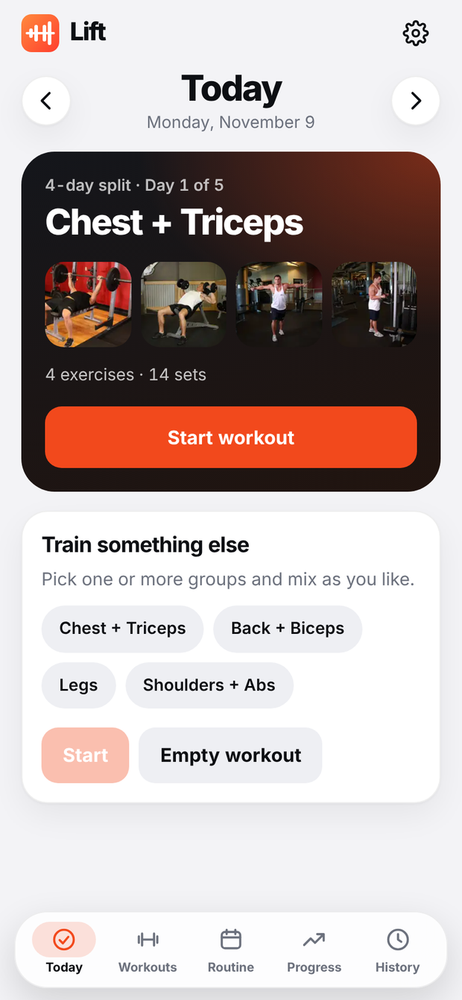
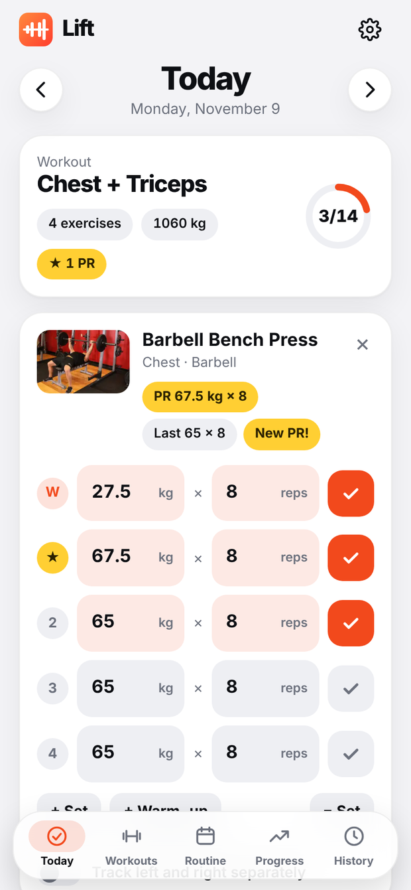
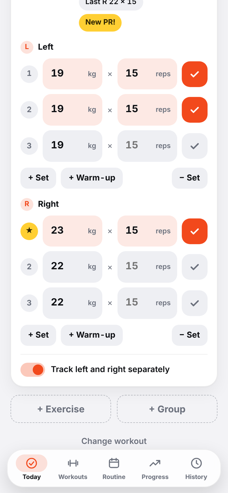
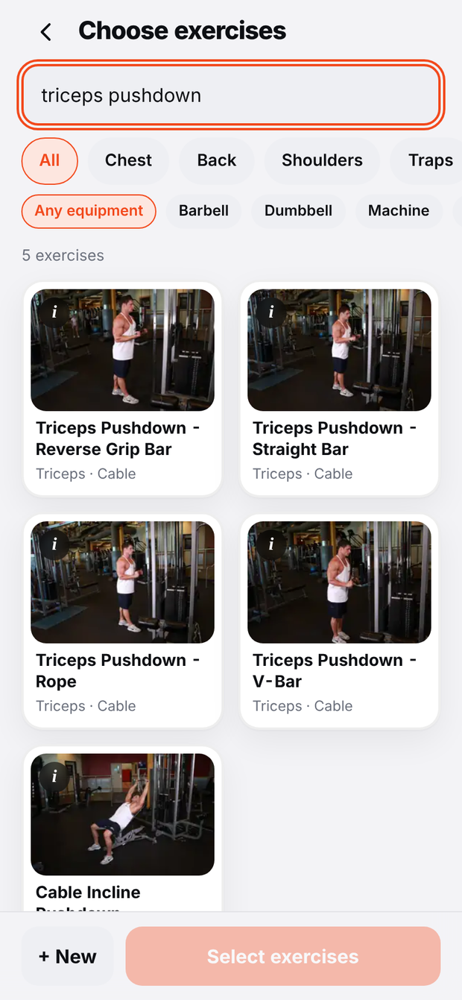
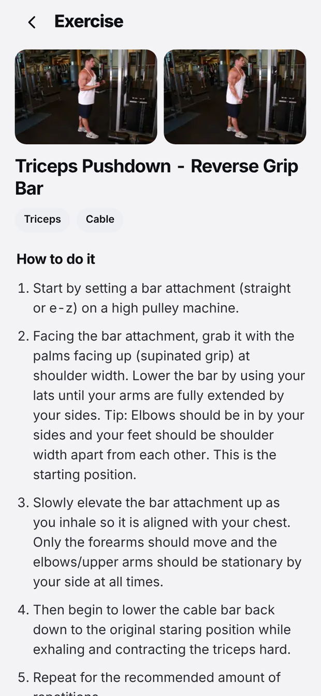
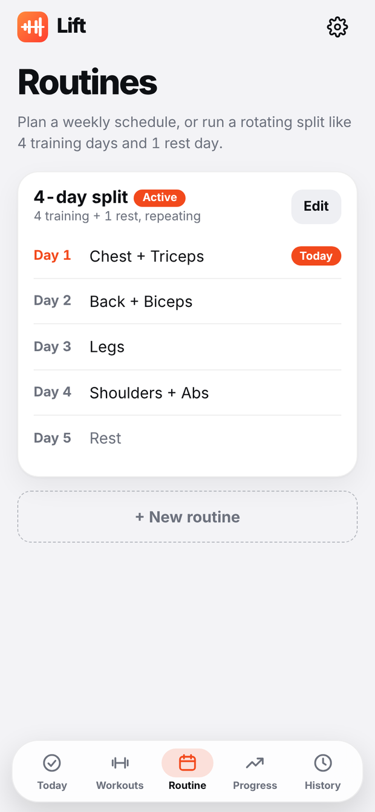
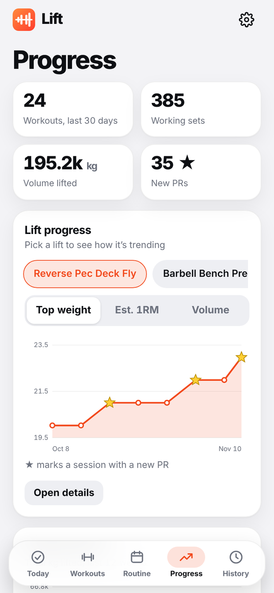
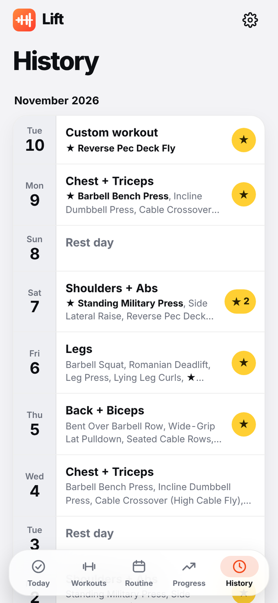

# Lift

Lift is an offline workout tracker for Android. It lets you define reusable workout groups, plan weekly or rotating training splits, log sets with per-exercise personal records, and review progress over time. All data stays on the device.

[](docs/build-and-release.md)
[](app/src/main/java/com/lift/tracker)
[](gradle/wrapper/gradle-wrapper.properties)
[](app/src/main/assets/js)
[](app/src/main/assets/index.html)
[](app/src/main/assets/css)
[](.prettierrc.json)
[](docs/version.md)
[](LICENSE)

<p align="center">
  
  
  
  
</p>
<p align="center">
  
  
  
  
</p>

## Overview

Lift is a native Android application whose interface is a single-page web app (plain HTML, CSS and JavaScript) rendered in a `WebView`. There is no backend, no account and no network permission. The web layer has no build step and can be opened directly in a desktop browser during development.

## Features

**Planning**

- Reusable workout groups (for example "Chest + Triceps"), each with exercises, warm-up sets, working sets and target reps.
- Weekly routines (Monday to Sunday) or rotating splits with a configurable number of training and rest days, such as four training days followed by one rest day.
- Any day can combine several groups.

**Logging**

- Sets are prefilled from the last session of the same exercise. Warm-up weights are derived from the working weight.
- Optional left and right tracking per exercise, with independent sets, weights, PRs and previous-session values for each side.
- Any past or future date can be logged or edited.

**Analysis**

- Personal records per exercise. A PR is a completed, non-warm-up set heavier than any earlier set; sides are compared separately.
- Progress tab: weekly volume, workouts per week, muscle balance over 30 days, and a per-lift chart of top weight, estimated one-rep max or volume.
- History tab with PR markers per day.

**Exercise library**

- 641 exercises with start and end photos and written instructions for 638 of them.
- Search with word stemming, aliases and equipment and muscle filters.
- Custom exercises.

**General**

- Fully offline. Light, dark or automatic theme. Kilograms or pounds. Backup and restore as text.

## Tech stack

| Layer | Technology | Notes |
| --- | --- | --- |
| Shell | Android, Java 8 source level | `Activity` hosting a `WebView`; minSdk 24, targetSdk 34 |
| Build | Gradle 8.7, Android Gradle Plugin 8.5.2 | Gradle wrapper included |
| UI | HTML5, CSS3, vanilla JavaScript | Classic scripts, no framework, no bundler |
| Storage | `localStorage` | Single JSON document, key `lift.v1` |
| Charts and icons | Generated inline SVG | No chart library |
| Images | WebP | Bundled in `assets/img`, two frames per exercise |
| Formatting | Prettier | Configuration in `.prettierrc.json` |

## Getting started

### Prerequisites

- Android Studio with JDK 17 or newer
- Android SDK Platform 34

### Run on a device or emulator

```bash
git clone <repository-url>
cd Lift
```

Open the `Lift` folder in Android Studio, wait for Gradle sync, and run the `app` configuration.

### Run in a desktop browser

Open `app/src/main/assets/index.html` in a browser. No server is required. Data is stored in that browser's local storage.

### Build from the command line

```bash
./gradlew assembleDebug      # app/build/outputs/apk/debug/app-debug.apk
./gradlew assembleRelease    # signed only if keystore.properties exists
```

See [docs/build-and-release.md](docs/build-and-release.md) for signing and release steps.

## Project structure

```
Lift/
├── app/
│   ├── build.gradle
│   └── src/main/
│       ├── AndroidManifest.xml
│       ├── java/com/lift/tracker/     WebView host activity
│       ├── res/                       Launcher icons, themes, colours
│       └── assets/                    The application
│           ├── index.html
│           ├── css/                   Tokens, components, one file per screen
│           ├── img/                   Exercise photos (NNN-0.webp, NNN-1.webp)
│           └── js/
│               ├── data/              Exercise library and instructions
│               ├── core/              State, search, stats, routines
│               ├── ui/                Views, sheets, charts, illustrations
│               ├── actions/           Click handlers
│               └── main.js
├── docs/                              Technical documentation
├── gradle/wrapper/
└── LICENSE
```

## Documentation

| Document | Contents |
| --- | --- |
| [docs/architecture.md](docs/architecture.md) | Runtime, script loading, rendering model, events |
| [docs/data-model.md](docs/data-model.md) | Stored data schema, definitions of PR, volume and estimated 1RM |
| [docs/exercise-library.md](docs/exercise-library.md) | Library format, identifiers, photos, search |
| [docs/development.md](docs/development.md) | Conventions and recipes for common changes |
| [docs/build-and-release.md](docs/build-and-release.md) | Build, signing, versioning |
| [docs/security-privacy.md](docs/security-privacy.md) | Permissions, data handling, WebView configuration |
| [docs/version.md](docs/version.md) | Version history |

## Data and privacy

The application declares no permissions. Workouts, routines, logs and settings are stored in the WebView's local storage on the device. A text backup can be created and restored from Settings. Details are in [docs/security-privacy.md](docs/security-privacy.md).

## Versioning

Lift follows semantic versioning. Each release is recorded in [docs/version.md](docs/version.md).

## Contributing

1. Create a branch from `main`.
2. Make the change and format it with Prettier (`npx prettier --write "app/src/main/assets/{css,js}/**/*"`).
3. Check the flows listed in [docs/development.md](docs/development.md#manual-test-checklist).
4. Open a pull request describing the change and, for user-visible changes, add an entry to [docs/version.md](docs/version.md).

## License

Released under the [MIT License](LICENSE).

Exercise names, muscle and equipment data, photos and instructions are derived from the [Free Exercise DB](https://github.com/yuhonas/free-exercise-db) by yuhonas, which is in the public domain under the Unlicense.
